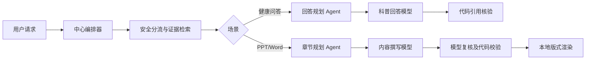

# 多 Agent P0：中心化编排（健康问答与科普文档）

本阶段的“Agent”是职责受限的执行角色，不代表自主医疗决策。现有安全图和证据门槛
仍是唯一可阻断的控制层；模型规划、复核不能改写其结论。

## 启用与费用

- 默认 `MULTI_AGENT_ENABLED=false`，原路径保持原有模型调用量。需在项目环境显式设为
  `true` 并重启后端；不安装后台自启动。测试仅使用模型桩，不调用真实付费 API。
- 健康问答：安全图结束且不是证据不足兜底／模型身份问答时，额外调用用户本轮选择的
  模型一次，规划角色只能选 `direct|clarify|brief`；失败时退回原回答路径。
- 科普文档：任务创建时固化开关值；开启时额外调用文档模型两次（章节规划、机器复核），
  加上原内容撰写共三次。复核 `high` 风险会停止渲染；机器复核不代表医学专业审核。

## 进度与工作流图契约

- 咨询 NDJSON 的 `start`／`done`／`error` 事件带 `workflow`。
- 文档创建、列表与详情响应带 `workflow`，检查点保存在 `generated_documents.workflow_stage`；
  重试时从现有任务重新执行，规划／复核模型也可能再次计费。
- `workflow` 仅含受控 `scene`、`mode`、`version`、`nodes`、`edges`，节点包含 `id`、
  `label`、`status` 和 `executor=code|model`。不包含原始健康文本、模型草稿或来源正文。
- 前端由 DSH 在既有回答结果区／文档任务卡渲染，可根据 `edges` 画图，并提供无图列表。
  不新增聊天输入框按钮。交接见根目录 `COORDINATION.md` §6。

## P0 边界

- 不让模型生成 Cypher、处方或个人诊断，也不以模型复核替代医疗审核。
- 不进行自主工具选择、无限循环、自我修改代码或跨用户共享记忆。
- 文档内容仍由既有来源校验与 OOXML 校验约束；咨询仍由既有红旗分流和引用审计约束。
- 当前没有前端工作流图；后端仅提供可视化所需状态与拓扑数据。
